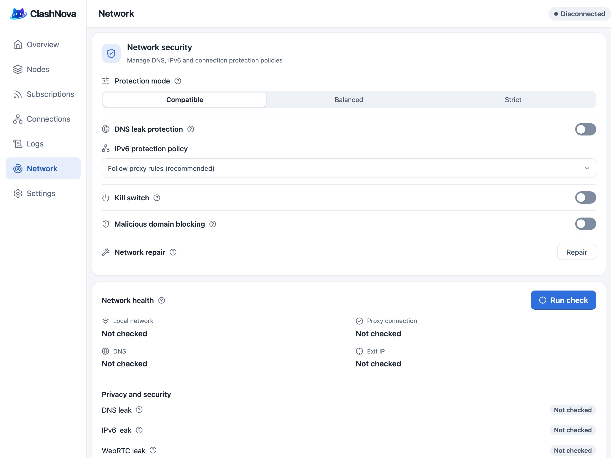

# ClashNova Desktop

Maintained by [clashnova-dev](https://github.com/clashnova-dev).

English · [简体中文](docs/i18n/README.zh-CN.md) · [Deutsch](docs/i18n/README.de.md) · [Français](docs/i18n/README.fr.md) · [日本語](docs/i18n/README.ja.md) · [한국어](docs/i18n/README.ko.md) · [Русский](docs/i18n/README.ru.md)

A desktop proxy client built on [sing-box](https://sing-box.sagernet.org/), written with Vue 3 and Tauri 2 for macOS, Windows, and Linux. Import a subscription and you're connected — the core is compiled from source and shipped inside the app, so parsing, routing, and the outbound connection all happen on your own machine.

Because the bundled sing-box core is compiled from source (GPL-3.0), the project as a whole is released under **GPL-3.0**.

<p align="center">
  
</p>

## Features

- **Overview** — connect or disconnect in one click, with live connection state, the current node, real-time up/down speed, and session usage. Subscription usage and the egress IP with its geo lookup are shown inline (hideable, refreshed manually or on a timer), alongside quick switching between your frequent nodes.
- **Nodes** — search, sort by latency, or run *Test all* to measure every node asynchronously; results stream in and can be re-sorted by lowest latency. Pick a node by hand, or leave it on automatic selection (the core's `urltest` group keeps choosing the fastest).
- **Subscriptions** — import Clash, sing-box, or universal (share-link) subscriptions from a URL or a local file; the conversion runs locally rather than through an online service. Refresh, copy, or remove each one, and see its usage and expiry when the provider reports them.
- **Connection and routing** — choose **system proxy**, **manual proxy**, or **TUN** (a virtual network interface, which requires system authorization). Switch between **rule** and **global** routing, and configure the local port, LAN access, and more. An active-connections list, the core's live log, and traffic statistics are all available.
- **System integration** — system tray, launch at login, and light / dark / follow-system themes. The interface is available in Simplified Chinese, English, 日本語, 한국어, Deutsch, Français, and Русский.

## Screenshots

| Nodes | Subscriptions | Network | Settings |
| :-: | :-: | :-: | :-: |
|  |  |  |  |

<p align="center">
  
</p>

## Building

You'll need Node.js with pnpm, Rust, Go, Python 3, and the Tauri system dependencies for your platform.

```sh
cp .env.example .env
pnpm install --frozen-lockfile
python3 scripts/prepare-sidecars.py   # compile the sing-box sidecar from source
pnpm tauri dev                         # development
pnpm tauri build                       # package a release build
```

`prepare-sidecars` builds the core and the subscription converter from source instead of downloading prebuilt binaries. Tauri's dev and build hooks run it automatically, so you don't need to invoke it by hand after changing the core sources.

To preview the UI without installing Rust or Go, run the frontend on its own with `pnpm dev` and open it in a browser. `browserBridge()` stubs out the native side, so anything that depends on the core — the connection, egress IP, live speed — still has to be verified in the real desktop build.

## Configuration

Build-time options are read by Vite from a `.env` file (ignored by `.gitignore`):

```
VITE_DEFAULT_SERVER=     # optional backend URL; leave empty to run as a standalone subscription client
VITE_ENABLE_LOGIN=false  # when false, the account login screen is hidden
VITE_GITHUB_URL=         # About page: project repository link; empty hides the row
```

Left at their defaults, the app is a self-contained subscription client that needs no server. The two flags are the extension point for wiring it to your own backend.

## Project layout

```
src/
  App.vue                 shell: side navigation plus the individual pages
  composables/useApp.ts   state hub (session / subscriptions / nodes / connection / settings)
  pages/                  Overview / Nodes / Subscriptions / Connections / Logs / Settings / Help
  i18n/                   message catalogs
  lib/                    connection state machine, subscription parsing, preferences, TUN service
  styles/app.css          light and dark design tokens
src-tauri/                Tauri (Rust) host: windows, tray, and the lifecycle of the core and TUN helper
```

The actual outbound traffic is forwarded by the bundled sing-box core.

## License

GPL-3.0. See [LICENSE](LICENSE). The project links the GPL-3.0 sing-box core, so distributions must follow the same license and make the corresponding source available.
