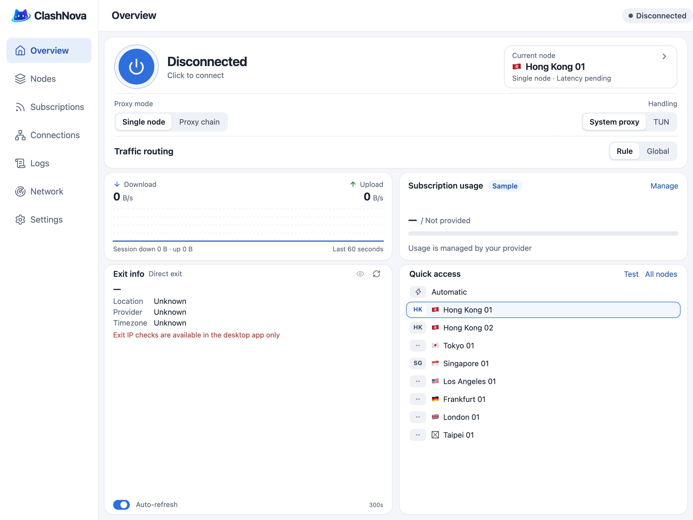
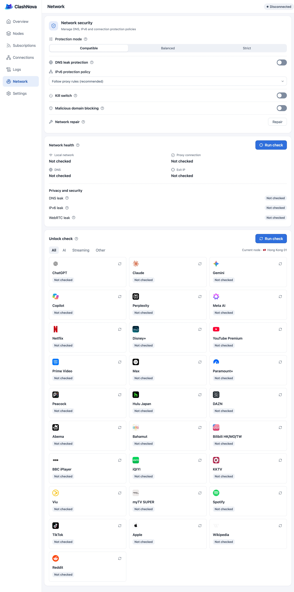

# ClashNova Desktop

<!-- i18n-nav -->
[English](../../README.md) · [简体中文](README.zh-CN.md) · **Deutsch** · [Français](README.fr.md) · [日本語](README.ja.md) · [한국어](README.ko.md) · [Русский](README.ru.md)

> Übersetzungen können dem englischen Hauptdokument hinterherhinken.

Ein Desktop-Proxy-Client auf Basis von [sing-box](https://sing-box.sagernet.org/), geschrieben mit Vue 3 und Tauri 2 für macOS, Windows und Linux. Abonnement importieren und verbunden sein – der Kernel wird aus dem Quellcode kompiliert und in der App mitgeliefert, sodass das Parsen, das Routing und die ausgehende Verbindung vollständig auf dem eigenen Rechner ablaufen.

Da der mitgelieferte sing-box-Kernel aus dem Quellcode kompiliert wird (GPL-3.0), wird das Projekt als Ganzes unter **GPL-3.0** veröffentlicht.

<p align="center">
  
</p>

## Funktionen

- **Übersicht** – mit einem Klick verbinden oder trennen, mit Live-Verbindungsstatus, aktuellem Knoten, Up-/Download-Geschwindigkeit in Echtzeit und Sitzungsverbrauch. Abonnementverbrauch und die Ausgangs-IP mit Geo-Zuordnung werden direkt angezeigt (ausblendbar, manuell oder per Timer aktualisiert), daneben der schnelle Wechsel zwischen häufig genutzten Knoten.
- **Knoten** – nach Name suchen, nach Latenz sortieren oder mit *Alle testen* jeden Knoten asynchron messen; die Ergebnisse treffen nach und nach ein und lassen sich nach niedrigster Latenz neu sortieren. Knoten von Hand wählen oder der automatischen Auswahl überlassen (die `urltest`-Gruppe des Kernels wählt fortlaufend den schnellsten).
- **Abonnements** – Clash-, sing-box- oder universelle (Share-Link-)Abonnements aus einer URL oder einer lokalen Datei importieren; die Umwandlung läuft lokal statt über einen Onlinedienst. Jedes lässt sich aktualisieren, kopieren oder entfernen, und Verbrauch und Ablauf werden angezeigt, sofern der Anbieter sie meldet.
- **Verbindung und Routing** – **Systemproxy**, **manueller Proxy** oder **TUN** (eine virtuelle Netzwerkschnittstelle, die eine Systemautorisierung erfordert). Zwischen **Regel-** und **Global-**Routing wechseln und lokalen Port, LAN-Zugriff und mehr konfigurieren. Eine Liste aktiver Verbindungen, das Live-Log des Kernels und Verkehrsstatistiken stehen bereit.
- **Systemintegration** – Infobereich (Tray), Autostart sowie helles / dunkles / systemabhängiges Design. Die Oberfläche ist auf Vereinfachtes Chinesisch, Englisch, 日本語, 한국어, Deutsch, Français und Русский verfügbar.

## Screenshots

| Übersicht | Knoten | Abonnements |
| :-: | :-: | :-: |
|  |  |  |

| Verbindungen | Logs | Einstellungen |
| :-: | :-: | :-: |
|  |  |  |

Die **Netzwerk**-Seite bündelt Verbindungsschutz-Richtlinien, Integritätsprüfungen und Streaming-/KI-Freischaltprüfungen:

<p align="center">
  
</p>

## Erstellen

Du brauchst Node.js mit pnpm, Rust, Go, Python 3 sowie die Tauri-Systemabhängigkeiten für deine Plattform.

```sh
cp .env.example .env
pnpm install --frozen-lockfile
python3 scripts/prepare-sidecars.py   # den sing-box-Sidecar aus dem Quellcode kompilieren
pnpm tauri dev                         # Entwicklung
pnpm tauri build                       # Release-Build paketieren
```

`prepare-sidecars` baut den Kernel und den Abonnement-Konverter aus dem Quellcode, statt vorkompilierte Binärdateien herunterzuladen. Die dev- und build-Hooks von Tauri führen es automatisch aus, sodass du es nach Änderungen am Kernel-Quellcode nicht von Hand aufrufen musst.

Um die Oberfläche ohne Rust oder Go anzusehen, läuft das Frontend auch allein mit `pnpm dev` im Browser. `browserBridge()` ersetzt die native Seite durch Stubs, daher muss alles, was vom Kernel abhängt – Verbindung, Ausgangs-IP, Live-Geschwindigkeit – im echten Desktop-Build geprüft werden.

## Unter macOS ausführen

Release-Builds sind nicht signiert oder notariell beglaubigt (es gibt kein Apple-Entwicklerzertifikat), daher kann macOS die heruntergeladene App ablehnen („ClashNova ist beschädigt …" oder eine Entwicklerwarnung). Entferne das Quarantäne-Flag und öffne die App dann normal – passe den Pfad an, falls du sie woanders installiert hast:

```sh
sudo xattr -rd com.apple.quarantine "/Applications/ClashNova.app"
```

## Konfiguration

Optionen zur Build-Zeit liest Vite aus einer `.env`-Datei (von `.gitignore` ignoriert):

```
VITE_DEFAULT_SERVER=     # optionale Backend-Adresse; leer = eigenständiger Abonnement-Client
VITE_ENABLE_LOGIN=false  # bei false wird die Kontoanmeldung ausgeblendet
```

Bei den Standardwerten ist die App ein eigenständiger Abonnement-Client, der keinen Server braucht. Die beiden Schalter sind der Erweiterungspunkt, um sie an ein eigenes Backend anzubinden.

## Projektstruktur

```
src/
  App.vue                 Hülle: Seitennavigation und die einzelnen Seiten
  composables/useApp.ts   Status-Hub (Sitzung / Abonnements / Knoten / Verbindung / Einstellungen)
  pages/                  Übersicht / Knoten / Abonnements / Verbindungen / Logs / Einstellungen / Hilfe
  i18n/                   Nachrichtenkataloge
  lib/                    Verbindungs-Zustandsmaschine, Abonnement-Parsing, Einstellungen, TUN-Dienst
  styles/app.css          helle und dunkle Design-Tokens
src-tauri/                Tauri-(Rust-)Host: Fenster, Tray und der Lebenszyklus von Kernel und TUN-Helfer
```

Der tatsächliche ausgehende Verkehr wird vom mitgelieferten sing-box-Kernel weitergeleitet.

## Lizenz

GPL-3.0, siehe [LICENSE](../../LICENSE). Das Projekt bindet den GPL-3.0-Kernel sing-box ein, daher müssen Distributionen derselben Lizenz folgen und den entsprechenden Quellcode bereitstellen.
