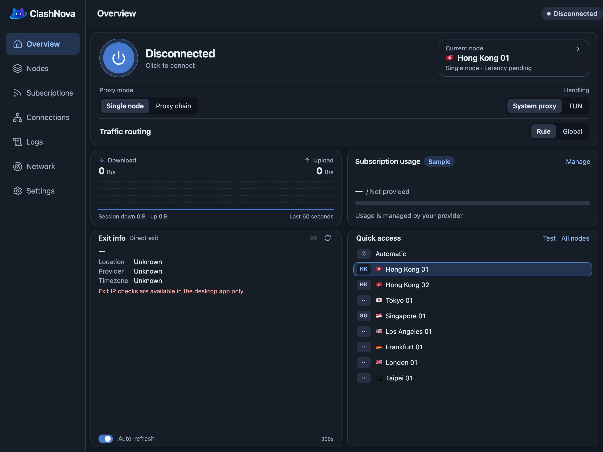
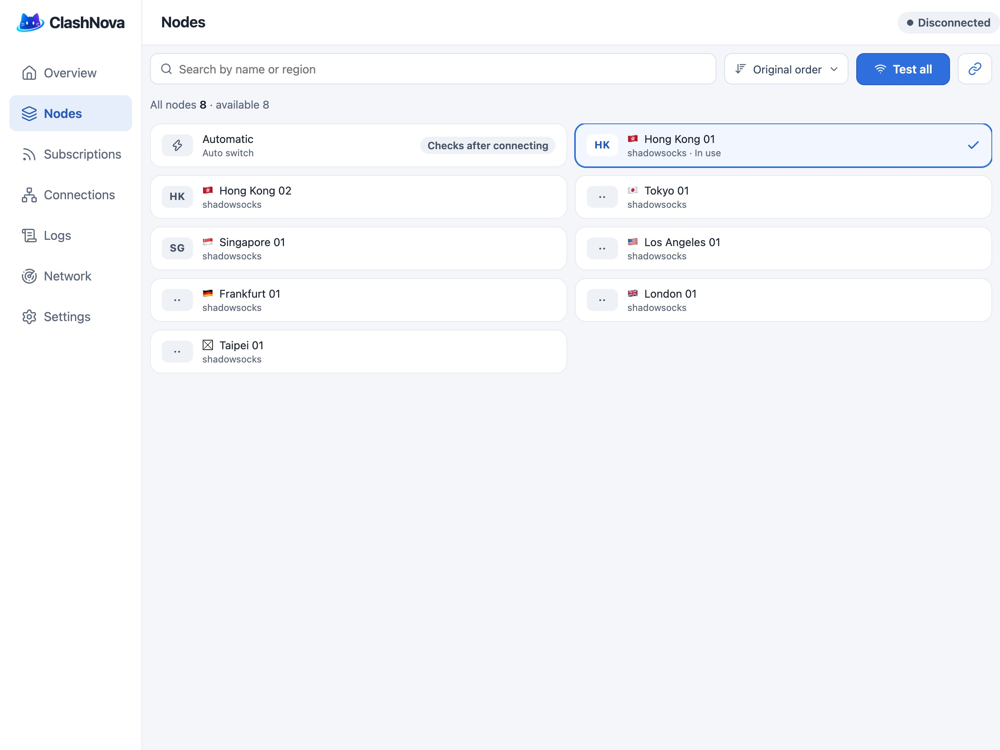

# ClashNova Desktop

<!-- i18n-nav -->
[English](../../README.md) · [简体中文](README.zh-CN.md) · [Deutsch](README.de.md) · [Français](README.fr.md) · **日本語** · [한국어](README.ko.md) · [Русский](README.ru.md)

> 翻訳は英語の主ドキュメントより古い場合があります。

[sing-box](https://sing-box.sagernet.org/) をベースにしたデスクトップ向けプロキシクライアントです。Vue 3 と Tauri 2 で作られ、macOS / Windows / Linux に対応します。サブスクリプションを取り込むだけで接続でき、コアはソースからコンパイルしてアプリに同梱されるため、解析・ルーティング・送信接続はすべて自分の端末内で完結します。

同梱の sing-box コアはソースからコンパイルされており(GPL-3.0)、そのため本プロジェクト全体を **GPL-3.0** で公開しています。

<p align="center">
  
</p>

## 機能

- **概要** — ワンクリックで接続・切断でき、接続状態・現在のノード・リアルタイムの上り下り速度・セッション使用量を表示します。サブスクリプション使用量と出口 IP(ジオ情報付き)はその場に表示され(非表示可、手動または定期更新)、よく使うノードをすばやく切り替えられます。
- **ノード** — 名前で検索、遅延で並べ替え、または「すべてテスト」で全ノードを非同期に計測します。結果は順次反映され、遅延の低い順に並べ替えられます。手動でノードを選ぶか、自動選択に任せます(コアの `urltest` グループが常に最速を選びます)。
- **サブスクリプション** — Clash / sing-box / 汎用(共有リンク)のサブスクリプションを URL またはローカルファイルから取り込みます。変換はオンラインサービスではなく端末内で行われます。各サブスクリプションは更新・コピー・削除でき、提供元が返す場合は使用量と有効期限も表示します。
- **接続とルーティング** — **システムプロキシ**・**手動プロキシ**・**TUN**(仮想ネットワークインターフェイス。システムの許可が必要)から選べます。**ルール**と**グローバル**のルーティングを切り替え、ローカルポートや LAN アクセスなども設定できます。アクティブな接続の一覧、コアのリアルタイムログ、トラフィック統計もそろっています。
- **システム連携** — システムトレイ、ログイン時の自動起動、ライト / ダーク / システム追従テーマ。インターフェイスは簡体字中国語・English・日本語・한국어・Deutsch・Français・Русский に対応します。

## スクリーンショット

| 概要 | ノード | サブスクリプション |
| :-: | :-: | :-: |
|  |  |  |

| 接続 | ログ | 設定 |
| :-: | :-: | :-: |
|  |  |  |

**ネットワーク**ページは、接続保護ポリシー、ヘルスチェック、ストリーミング / AI のアンロック判定をまとめています:

<p align="center">
  
</p>

## ビルド

Node.js と pnpm、Rust、Go、Python 3、および各プラットフォーム向けの Tauri システム依存関係が必要です。

```sh
cp .env.example .env
pnpm install --frozen-lockfile
python3 scripts/prepare-sidecars.py   # sing-box sidecar をソースからコンパイル
pnpm tauri dev                         # 開発
pnpm tauri build                       # リリース版をパッケージ化
```

`prepare-sidecars` はコアとサブスクリプション変換器をソースからビルドし、ビルド済みバイナリはダウンロードしません。Tauri の dev・build フックが自動的に実行するため、コアのソースを変更しても手動で呼び出す必要はありません。

Rust や Go を入れずに UI だけを確認したい場合は、`pnpm dev` でフロントエンドだけを起動してブラウザで開けます。`browserBridge()` がネイティブ側をスタブ化するため、コアに依存する部分——接続・出口 IP・リアルタイム速度——は実際のデスクトップビルドで検証する必要があります。

## macOS で実行する

リリースビルドはコード署名も公証(notarization)も行われていないため(Apple Developer 証明書がないため)、ダウンロードしたビルドの起動を macOS が拒否することがあります(「ClashNova は壊れています…」や開発元を確認できない旨の警告)。隔離フラグを解除してから通常どおり開いてください。別の場所にインストールした場合はパスを調整してください:

```sh
sudo xattr -rd com.apple.quarantine "/Applications/ClashNova.app"
```

## 設定

ビルド時のオプションは Vite が `.env` ファイル(`.gitignore` で無視)から読み込みます。

```
VITE_DEFAULT_SERVER=     # 任意のバックエンドアドレス。空にすると単体のサブスクリプションクライアントとして動作
VITE_ENABLE_LOGIN=false  # false のときはアカウントログイン画面を非表示にする
```

デフォルトのままなら、アプリはサーバーを必要としない単体のサブスクリプションクライアントです。この 2 つのフラグが、独自のバックエンドに接続するための拡張ポイントです。

## プロジェクト構成

```
src/
  App.vue                 外枠:サイドナビゲーションと各ページ
  composables/useApp.ts   状態ハブ(セッション / サブスクリプション / ノード / 接続 / 設定)
  pages/                  概要 / ノード / サブスクリプション / 接続 / ログ / 設定 / ヘルプ
  i18n/                   メッセージカタログ
  lib/                    接続ステートマシン、サブスクリプション解析、設定、TUN サービス
  styles/app.css          ライト・ダークのデザイントークン
src-tauri/                Tauri(Rust)ホスト:ウィンドウ、トレイ、コアと TUN ヘルパーのライフサイクル
```

実際の送信トラフィックは同梱の sing-box コアが転送します。

## ライセンス

GPL-3.0。[LICENSE](../../LICENSE) を参照してください。本プロジェクトは GPL-3.0 の sing-box コアをリンクしているため、配布時は同じライセンスに従い、対応するソースコードを提供する必要があります。
