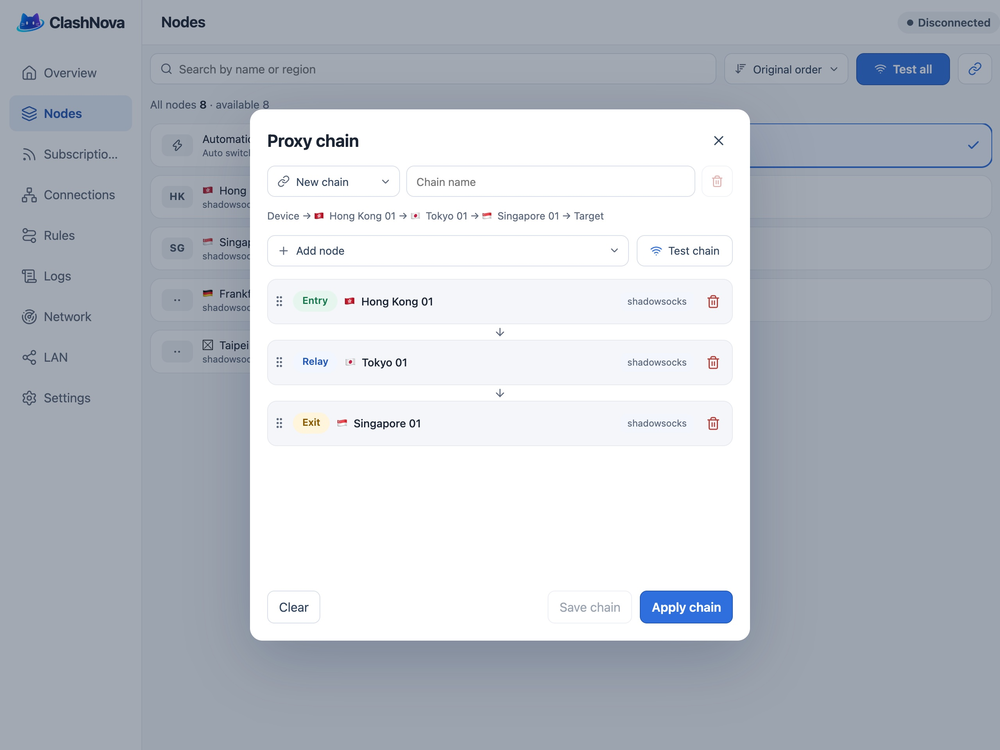
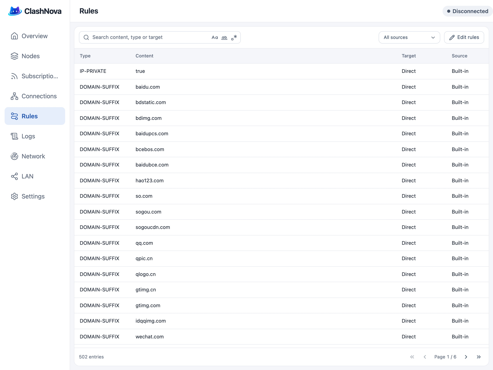

<div align="center">


<h1>ClashNova Desktop</h1>

<p>
  <b><a href="https://sing-box.sagernet.org/">sing-box</a> をベースにしたローカルファーストのプロキシクライアント。</b><br/>
  サブスクリプションを取り込むだけで接続でき、解析・ルーティング・送信接続はすべて自分の端末で完結します。
</p>

<p>
  <a href="../../LICENSE"></a>
  
  
  
  
</p>

<p>
  <a href="../../README.md">English</a> ·
  <a href="README.zh-CN.md">简体中文</a> ·
  <a href="README.de.md">Deutsch</a> ·
  <a href="README.fr.md">Français</a> ·
  <b>日本語</b> ·
  <a href="README.ko.md">한국어</a> ·
  <a href="README.ru.md">Русский</a>
</p>


<p><a href="https://github.com/clashnova-dev">clashnova-dev</a></p>

</div>

> 翻訳は英語の主ドキュメントより古い場合があります。
## ✨ 機能

- **概要** — ワンクリックで接続・切断でき、接続状態・現在のノード・リアルタイムの上り下り速度・セッション使用量を表示します。サブスクリプション使用量と出口 IP(ジオ情報付き)はその場に表示され(非表示可、手動または定期更新)、よく使うノードをすばやく切り替えられます。
- **ノード** — 名前で検索、遅延で並べ替え、または「すべてテスト」で全ノードを非同期に計測します。結果は順次反映され、遅延の低い順に並べ替えられます。手動でノードを選ぶか、自動選択に任せます(コアの `urltest` グループが常に最速を選びます)。
- **サブスクリプション** — Clash / sing-box / 汎用(共有リンク)のサブスクリプションを URL またはローカルファイルから取り込みます。変換はオンラインサービスではなく端末内で行われます。各サブスクリプションは更新・コピー・削除でき、提供元が返す場合は使用量と有効期限も表示します。
- **接続とルーティング** — **システムプロキシ**・**手動プロキシ**・**TUN**(仮想ネットワークインターフェイス。システムの許可が必要)から選べます。**ルール**と**グローバル**のルーティングを切り替え、ローカルポートや LAN アクセスなども設定できます。アクティブな接続の一覧、コアのリアルタイムログ、トラフィック統計もそろっています。
- **システム連携** — システムトレイ、ログイン時の自動起動、ライト / ダーク / システム追従テーマ。インターフェイスは簡体字中国語・English・日本語・한국어・Deutsch・Français・Русский に対応します。

## 🌟 特長

ただのサブスクリプションクライアントにとどまらない機能をいくつか。

### プロキシチェーン

トラフィックを複数のノードに順番に中継させます——入口、任意の数の中継、出口。チェーンを手動で組み、エンドツーエンドのレイテンシを実測し、よく使うものは名前付きプリセットとして保存できます。レイテンシはホップごとに積み上がり、チェーン全体は最も弱い一か所と同じ信頼性しかないため、エディターは常に経路全体を表示します。

<p align="center"></p>

### ネットワーク保護とチェック

**ネットワーク**ページは、トラフィックがどのように端末から出ていくかに関するものをまとめています。プロキシの適用方法——システムプロキシ、TUN、手動——を選べ、各モードが何をカバーし何をカバーしないかを平易に説明します。**キルスイッチ**(TUN モード)はトンネルが切れた瞬間にすべてのトラフィックを遮断し、実接続へ漏れないようにします。必要に応じて、ヘルスチェック(ローカルネットワーク、プロキシ到達性、DNS、出口 IP)、DNS / IPv6 / WebRTC リークテスト、ストリーミング / AI サービスのアンロック判定を実行できます。

<p align="center"></p>

### LAN 転送

同じネットワーク上の自分の端末へ、サーバーやクラウドを介さずにテキストやファイルを送れます。個人向けのファイルヘルパーのチャットのように動作します:端末を一度ペアリングすれば、あとはスレッドでメッセージやファイルをやり取りできます。ペアリングで信頼が確立されるため、ペア済みの端末は自動で受信できます。

<p align="center"></p>

### ルーティングルール

実際に有効なルーティングテーブルを確認できます——各ルールの種類、何にマッチするか、トラフィックの送り先(直接 / プロキシ / ブロック)、そしてそれがサブスクリプション由来か内蔵の既定値か。内容・種類・送り先で検索して、特定のドメインがなぜその経路を通るのかを把握できます。

<p align="center"></p>

## 📸 スクリーンショット

| 概要 | ノード | サブスクリプション |
| :-: | :-: | :-: |
|  |  |  |

| 接続 | ログ | 設定 |
| :-: | :-: | :-: |
|  |  |  |

## 🛠️ ビルド

Node.js と pnpm、Rust、Go、Python 3、および各プラットフォーム向けの Tauri システム依存関係が必要です。

```sh
cp .env.example .env
pnpm install --frozen-lockfile
python3 scripts/prepare-sidecars.py   # sing-box sidecar をソースからコンパイル
pnpm tauri dev                         # 開発
pnpm tauri build                       # リリース版をパッケージ化
```

`prepare-sidecars` はコアとサブスクリプション変換器をソースからビルドし、ビルド済みバイナリはダウンロードしません。Tauri の dev・build フックが自動的に実行するため、コアのソースを変更しても手動で呼び出す必要はありません。

Rust や Go を入れずに UI だけを確認したい場合は、`pnpm dev` でフロントエンドだけを起動してブラウザで開けます。`browserBridge()` がネイティブ側をスタブ化するため、コアに依存する部分——接続・出口 IP・リアルタイム速度——は実際のデスクトップビルドで検証する必要があります。

## 🍎 macOS で実行する

リリースビルドはコード署名も公証(notarization)も行われていないため(Apple Developer 証明書がないため)、ダウンロードしたビルドの起動を macOS が拒否することがあります(「ClashNova は壊れています…」や開発元を確認できない旨の警告)。隔離フラグを解除してから通常どおり開いてください。別の場所にインストールした場合はパスを調整してください:

```sh
sudo xattr -rd com.apple.quarantine "/Applications/ClashNova.app"
```

## ⚙️ 設定

ビルド時のオプションは Vite が `.env` ファイル(`.gitignore` で無視)から読み込みます。

```
VITE_DEFAULT_SERVER=     # 任意のバックエンドアドレス。空にすると単体のサブスクリプションクライアントとして動作
VITE_ENABLE_LOGIN=false  # false のときはアカウントログイン画面を非表示にする
```

デフォルトのままなら、アプリはサーバーを必要としない単体のサブスクリプションクライアントです。この 2 つのフラグが、独自のバックエンドに接続するための拡張ポイントです。

## 🗂️ プロジェクト構成

```
src/
  App.vue                 外枠:サイドナビゲーションと各ページ
  composables/useApp.ts   状態ハブ(セッション / サブスクリプション / ノード / 接続 / 設定)
  pages/                  概要 / ノード / サブスクリプション / 接続 / ログ / 設定 / ヘルプ
  i18n/                   メッセージカタログ
  lib/                    接続ステートマシン、サブスクリプション解析、設定、TUN サービス
  styles/app.css          ライト・ダークのデザイントークン
src-tauri/                Tauri(Rust)ホスト:ウィンドウ、トレイ、コアと TUN ヘルパーのライフサイクル
```

実際の送信トラフィックは同梱の sing-box コアが転送します。

## 📄 ライセンス

GPL-3.0。[LICENSE](../../LICENSE) を参照してください。本プロジェクトは GPL-3.0 の sing-box コアをリンクしているため、配布時は同じライセンスに従い、対応するソースコードを提供する必要があります。
