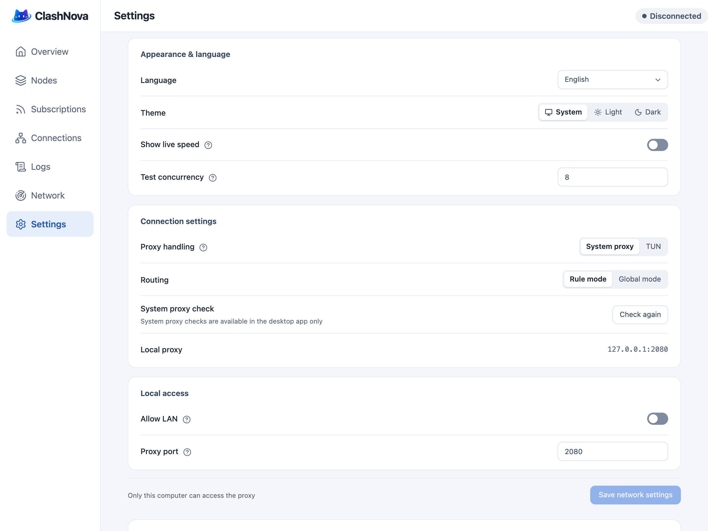

# ClashNova Desktop

<!-- i18n-nav -->
[English](../../README.md) · [简体中文](README.zh-CN.md) · [Deutsch](README.de.md) · [Français](README.fr.md) · [日本語](README.ja.md) · **한국어** · [Русский](README.ru.md)

> 번역은 영어 기본 문서보다 늦을 수 있습니다.

[sing-box](https://sing-box.sagernet.org/) 기반의 데스크톱 프록시 클라이언트로, Vue 3와 Tauri 2로 작성되었으며 macOS / Windows / Linux를 지원합니다. 구독을 가져오기만 하면 연결됩니다 — 코어는 소스에서 컴파일되어 앱에 내장되므로 파싱, 라우팅, 아웃바운드 연결이 모두 사용자 기기 안에서 이루어집니다.

내장된 sing-box 코어는 소스에서 컴파일되므로(GPL-3.0), 프로젝트 전체가 **GPL-3.0**으로 배포됩니다.

<p align="center">
  
</p>

## 기능

- **개요** — 한 번의 클릭으로 연결하거나 끊고, 연결 상태·현재 노드·실시간 업/다운 속도·세션 사용량을 표시합니다. 구독 사용량과 지역 정보가 포함된 출구 IP가 바로 표시되며(숨김 가능, 수동 또는 타이머로 새로고침), 자주 쓰는 노드 사이를 빠르게 전환할 수 있습니다.
- **노드** — 이름으로 검색하고 지연 시간으로 정렬하거나, *전체 테스트*로 모든 노드를 비동기로 측정합니다. 결과가 순차적으로 들어오며 지연이 낮은 순으로 다시 정렬할 수 있습니다. 직접 노드를 고르거나 자동 선택에 맡길 수 있습니다(코어의 `urltest` 그룹이 가장 빠른 노드를 계속 고릅니다).
- **구독** — Clash, sing-box, 범용(공유 링크) 구독을 URL이나 로컬 파일에서 가져옵니다. 변환은 온라인 서비스가 아니라 로컬에서 이루어집니다. 각 구독은 새로고침·복사·삭제할 수 있고, 제공자가 알려주면 사용량과 만료일도 표시됩니다.
- **연결과 라우팅** — **시스템 프록시**, **수동 프록시**, **TUN**(가상 네트워크 인터페이스, 시스템 권한 필요) 중에서 선택합니다. **규칙**과 **전역** 라우팅을 전환하고 로컬 포트, LAN 접근 등을 설정할 수 있습니다. 활성 연결 목록, 코어의 실시간 로그, 트래픽 통계를 모두 제공합니다.
- **시스템 통합** — 시스템 트레이, 로그인 시 자동 시작, 라이트 / 다크 / 시스템 따름 테마. 인터페이스는 간체 중국어, English, 日本語, 한국어, Deutsch, Français, Русский를 지원합니다.

## 스크린샷

| 노드 | 구독 | 네트워크 | 설정 |
| :-: | :-: | :-: | :-: |
|  |  |  |  |

<p align="center">
  
</p>

## 빌드

Node.js와 pnpm, Rust, Go, Python 3, 그리고 플랫폼에 맞는 Tauri 시스템 의존성이 필요합니다.

```sh
cp .env.example .env
pnpm install --frozen-lockfile
python3 scripts/prepare-sidecars.py   # sing-box sidecar를 소스에서 컴파일
pnpm tauri dev                         # 개발
pnpm tauri build                       # 배포 빌드 패키징
```

`prepare-sidecars`는 미리 빌드된 바이너리를 내려받지 않고 코어와 구독 변환기를 소스에서 빌드합니다. Tauri의 dev·build 훅이 자동으로 실행하므로 코어 소스를 수정한 뒤 직접 호출할 필요가 없습니다.

Rust나 Go를 설치하지 않고 UI만 미리 보려면 `pnpm dev`로 프런트엔드만 실행해 브라우저에서 열면 됩니다. `browserBridge()`가 네이티브 쪽을 스텁으로 대체하므로 코어에 의존하는 기능 — 연결, 출구 IP, 실시간 속도 — 은 실제 데스크톱 빌드에서 확인해야 합니다.

## 설정

빌드 시 옵션은 Vite가 `.env` 파일(gitignore 처리됨)에서 읽습니다.

```
VITE_DEFAULT_SERVER=     # 선택적 백엔드 주소. 비워 두면 독립 구독 클라이언트로 동작
VITE_ENABLE_LOGIN=false  # false이면 계정 로그인 화면을 숨김
```

기본값 그대로면 앱은 서버가 필요 없는 독립 구독 클라이언트입니다. 이 두 플래그가 자체 백엔드에 연결하기 위한 확장 지점입니다.

## 프로젝트 구조

```
src/
  App.vue                 셸: 사이드 내비게이션과 각 페이지
  composables/useApp.ts   상태 허브(세션 / 구독 / 노드 / 연결 / 설정)
  pages/                  개요 / 노드 / 구독 / 연결 / 로그 / 설정 / 도움말
  i18n/                   메시지 카탈로그
  lib/                    연결 상태 머신, 구독 파싱, 환경설정, TUN 서비스
  styles/app.css          라이트·다크 디자인 토큰
src-tauri/                Tauri(Rust) 호스트: 창, 트레이, 코어와 TUN 헬퍼의 생명주기
```

실제 아웃바운드 트래픽은 내장된 sing-box 코어가 전달합니다.

## 라이선스

GPL-3.0. [LICENSE](../../LICENSE)를 참고하세요. 이 프로젝트는 GPL-3.0인 sing-box 코어를 링크하므로, 배포 시 같은 라이선스를 따르고 해당 소스 코드를 제공해야 합니다.
