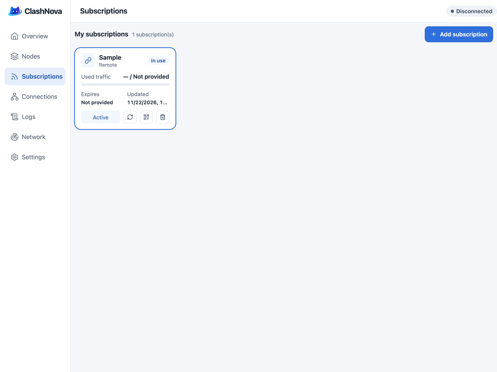
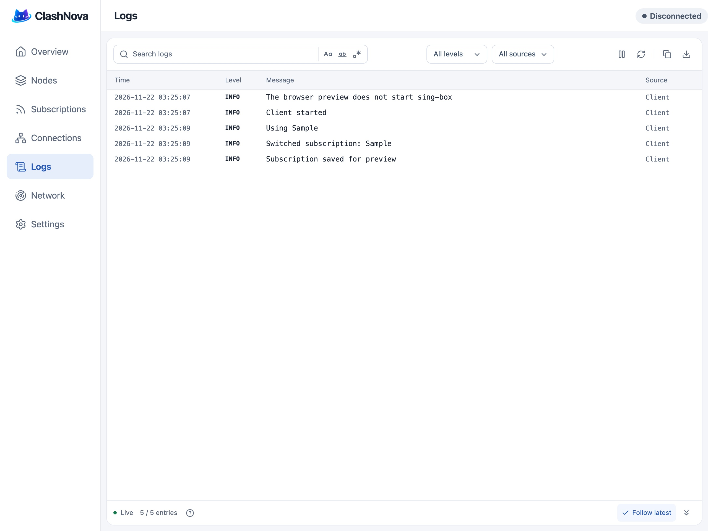

<div align="center">


<h1>ClashNova Desktop</h1>

<p>
  <b><a href="https://sing-box.sagernet.org/">sing-box</a> 기반의 로컬 우선 프록시 클라이언트.</b><br/>
  구독을 가져오기만 하면 연결 —— 파싱, 라우팅, 아웃바운드 연결이 모두 기기에서 이루어집니다.
</p>

<p>
  <a href="../../LICENSE"></a>
  
  
  
  
  <a href="https://x.com/ClashNova2048"></a>
</p>

<p>
  <a href="../../README.md">English</a> ·
  <a href="README.zh-CN.md">简体中文</a> ·
  <a href="README.de.md">Deutsch</a> ·
  <a href="README.fr.md">Français</a> ·
  <a href="README.ja.md">日本語</a> ·
  <b>한국어</b> ·
  <a href="README.ru.md">Русский</a>
</p>


</div>

> 번역은 영어 기본 문서보다 늦을 수 있습니다.
## ✨ 기능

- **개요** — 한 번의 클릭으로 연결하거나 끊고, 연결 상태·현재 노드·실시간 업/다운 속도·세션 사용량을 표시합니다. 구독 사용량과 지역 정보가 포함된 출구 IP가 바로 표시되며(숨김 가능, 수동 또는 타이머로 새로고침), 자주 쓰는 노드 사이를 빠르게 전환할 수 있습니다.
- **노드** — 이름으로 검색하고 지연 시간으로 정렬하거나, *전체 테스트*로 모든 노드를 비동기로 측정합니다. 결과가 순차적으로 들어오며 지연이 낮은 순으로 다시 정렬할 수 있습니다. 직접 노드를 고르거나 자동 선택에 맡길 수 있습니다(코어의 `urltest` 그룹이 가장 빠른 노드를 계속 고릅니다).
- **구독** — Clash, sing-box, 범용(공유 링크) 구독을 URL이나 로컬 파일에서 가져옵니다. 변환은 온라인 서비스가 아니라 로컬에서 이루어집니다. 각 구독은 새로고침·복사·삭제할 수 있고, 제공자가 알려주면 사용량과 만료일도 표시됩니다.
- **연결과 라우팅** — **시스템 프록시**, **수동 프록시**, **TUN**(가상 네트워크 인터페이스, 시스템 권한 필요) 중에서 선택합니다. **규칙**과 **전역** 라우팅을 전환하고 로컬 포트, LAN 접근 등을 설정할 수 있습니다. 활성 연결 목록, 코어의 실시간 로그, 트래픽 통계를 모두 제공합니다.
- **시스템 통합** — 시스템 트레이, 로그인 시 자동 시작, 라이트 / 다크 / 시스템 따름 테마. 인터페이스는 간체 중국어, English, 日本語, 한국어, Deutsch, Français, Русский를 지원합니다.

## 🌟 주요 기능

단순한 구독 클라이언트를 넘어서는 몇 가지 기능.

### 프록시 체인

트래픽을 여러 노드를 순서대로 거치게 합니다 — 입구 하나, 임의 개수의 중계, 출구 하나. 체인을 직접 구성하고 종단 간 지연 시간을 측정하며, 자주 쓰는 체인은 이름을 붙여 프리셋으로 저장할 수 있습니다. 지연 시간은 홉마다 쌓이고 체인은 가장 약한 고리만큼만 안정적이므로, 편집기는 전체 경로를 항상 보여 줍니다.

<p align="center"></p>

### 네트워크 보호 및 점검

**네트워크** 페이지는 트래픽이 기기를 어떻게 빠져나가는지에 관한 모든 것을 모아 둡니다. 프록시 적용 방식 — 시스템 프록시, TUN, 수동 — 을 고를 수 있고, 각 모드가 무엇을 포함하고 포함하지 않는지 쉬운 말로 설명합니다. **킬 스위치**(TUN 모드)는 터널이 끊기는 순간 모든 트래픽을 차단해 실제 연결로 새어 나가지 않게 합니다. 필요할 때 상태 점검(로컬 네트워크, 프록시 도달성, DNS, 출구 IP), DNS / IPv6 / WebRTC 누출 검사, 스트리밍 / AI 서비스 잠금 해제 감지를 실행할 수 있습니다.

<p align="center"></p>

### LAN 전송

같은 네트워크에 있는 자신의 다른 기기로 서버나 클라우드를 거치지 않고 텍스트와 파일을 보냅니다. 개인용 파일 도우미 대화처럼 작동합니다: 기기를 한 번 페어링하면 이후에는 대화 스레드에서 메시지와 파일을 주고받습니다. 페어링으로 신뢰가 성립되므로, 페어링된 기기는 자동으로 수신할 수 있습니다.

<p align="center"></p>

### 라우팅 규칙

실제로 적용 중인 라우팅 테이블을 살펴봅니다 — 각 규칙의 유형, 무엇과 일치하는지, 트래픽을 어디로 보내는지(직접 / 프록시 / 차단), 그리고 그것이 구독에서 왔는지 내장 기본값에서 왔는지. 내용, 유형, 대상으로 검색해 특정 도메인이 왜 그 경로를 타는지 확인할 수 있습니다.

<p align="center"></p>

## 📸 스크린샷

| 개요 | 노드 | 구독 |
| :-: | :-: | :-: |
|  |  |  |

| 연결 | 로그 | 설정 |
| :-: | :-: | :-: |
|  |  |  |

## 🛠️ 빌드

Node.js와 pnpm, Rust, Go, Python 3, 그리고 플랫폼에 맞는 Tauri 시스템 의존성이 필요합니다.

```sh
cp .env.example .env
pnpm install --frozen-lockfile
python3 scripts/prepare-sidecars.py   # sing-box sidecar를 소스에서 컴파일
pnpm tauri dev                         # 개발
pnpm tauri build                       # 배포 빌드 패키징
```

`prepare-sidecars`는 미리 빌드된 바이너리를 내려받지 않고 코어와 구독 변환기를 소스에서 빌드합니다. Tauri의 dev·build 훅이 자동으로 실행하므로 코어 소스를 수정한 뒤 직접 호출할 필요가 없습니다.

Rust나 Go를 설치하지 않고 UI만 미리 보려면 `pnpm dev`로 프런트엔드만 실행해 브라우저에서 열면 됩니다. `browserBridge()`가 네이티브 쪽을 스텁으로 대체하므로 코어에 의존하는 기능 — 연결, 출구 IP, 실시간 속도 — 은 실제 데스크톱 빌드에서 확인해야 합니다.

## 🍎 macOS에서 실행

릴리스 빌드는 코드 서명과 공증(notarization)이 되어 있지 않아(Apple 개발자 인증서가 없음), 내려받은 빌드를 macOS가 실행 거부할 수 있습니다(「ClashNova이(가) 손상되었습니다…」 또는 확인되지 않은 개발자 경고). 격리 플래그를 제거한 뒤 정상적으로 여세요. 다른 위치에 설치했다면 경로를 바꾸세요:

```sh
sudo xattr -rd com.apple.quarantine "/Applications/ClashNova.app"
```

## ⚙️ 설정

빌드 시 옵션은 Vite가 `.env` 파일(gitignore 처리됨)에서 읽습니다.

```
VITE_DEFAULT_SERVER=     # 선택적 백엔드 주소. 비워 두면 독립 구독 클라이언트로 동작
VITE_ENABLE_LOGIN=false  # false이면 계정 로그인 화면을 숨김
```

기본값 그대로면 앱은 서버가 필요 없는 독립 구독 클라이언트입니다. 이 두 플래그가 자체 백엔드에 연결하기 위한 확장 지점입니다.

## 🗂️ 프로젝트 구조

```
src/
  App.vue                 셸: 사이드 내비게이션과 각 페이지
  composables/useApp.ts   상태 허브(세션 / 구독 / 노드 / 연결 / 설정)
  pages/                  개요 / 노드 / 구독 / 연결 / 로그 / 설정 / 도움말
  i18n/                   메시지 카탈로그
  lib/                    연결 상태 머신, 구독 파싱, 환경설정, TUN 서비스
  styles/app.css          라이트·다크 디자인 토큰
src-tauri/                Tauri(Rust) 호스트: 창, 트레이, 코어와 TUN 헬퍼의 생명주기
```

실제 아웃바운드 트래픽은 내장된 sing-box 코어가 전달합니다.

## 📄 라이선스

GPL-3.0. [LICENSE](../../LICENSE)를 참고하세요. 이 프로젝트는 GPL-3.0인 sing-box 코어를 링크하므로, 배포 시 같은 라이선스를 따르고 해당 소스 코드를 제공해야 합니다.
