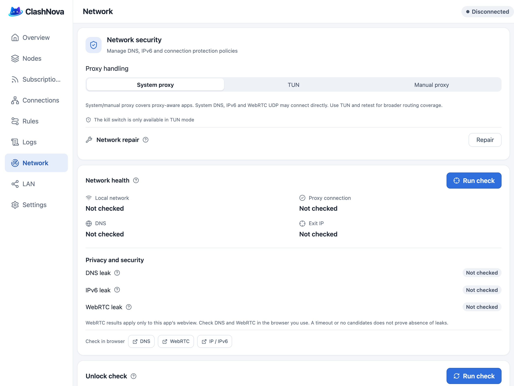
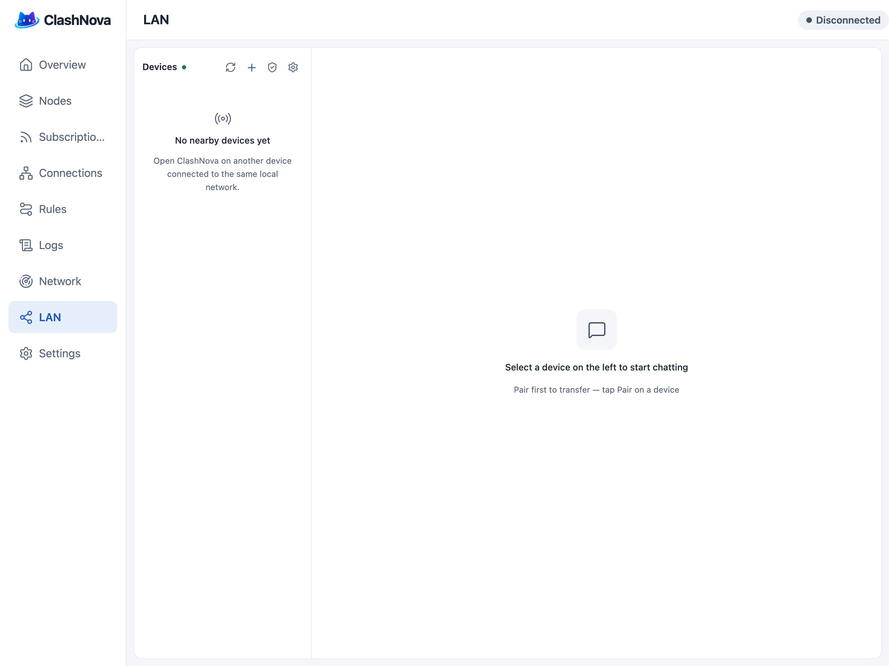

<div align="center">


<h1>ClashNova Desktop</h1>

<p>
  <b>Локальный прокси-клиент на основе <a href="https://sing-box.sagernet.org/">sing-box</a>.</b><br/>
  Импортируйте подписку — и вы подключены: разбор, маршрутизация и исходящее соединение выполняются на вашем устройстве.
</p>

<p>
  <a href="../../LICENSE"></a>
  
  
  
  
</p>

<p>
  <a href="../../README.md">English</a> ·
  <a href="README.zh-CN.md">简体中文</a> ·
  <a href="README.de.md">Deutsch</a> ·
  <a href="README.fr.md">Français</a> ·
  <a href="README.ja.md">日本語</a> ·
  <a href="README.ko.md">한국어</a> ·
  <b>Русский</b>
</p>


<p><a href="https://github.com/clashnova-dev">clashnova-dev</a></p>

</div>

> Переводы могут отставать от основного документа на английском.
## ✨ Возможности

- **Обзор** — подключение и отключение одним щелчком, с отображением состояния соединения, текущего узла, скорости приёма/передачи в реальном времени и расхода за сессию. Расход подписки и исходящий IP с геоданными показываются на месте (можно скрыть, обновление вручную или по таймеру), рядом — быстрое переключение между часто используемыми узлами.
- **Узлы** — поиск по имени, сортировка по задержке или *Проверить все* для асинхронного измерения каждого узла; результаты приходят постепенно и пересортировываются по наименьшей задержке. Выбирайте узел вручную или доверьте автоматическому выбору (группа `urltest` ядра постоянно выбирает самый быстрый).
- **Подписки** — импорт подписок Clash, sing-box или универсальных (ссылки-share) из URL или локального файла; преобразование выполняется локально, а не через онлайн-сервис. Каждую можно обновить, скопировать или удалить, а расход и срок действия показываются, если их сообщает провайдер.
- **Соединение и маршрутизация** — **системный прокси**, **ручной прокси** или **TUN** (виртуальный сетевой интерфейс, требующий системного разрешения). Переключайтесь между маршрутизацией **по правилам** и **глобальной**, настраивайте локальный порт, доступ из локальной сети и другое. Доступны список активных соединений, живой журнал ядра и статистика трафика.
- **Интеграция с системой** — системный трей, запуск при входе и светлая / тёмная / системная темы. Интерфейс доступен на упрощённом китайском, английском, 日本語, 한국어, Deutsch, Français и Русском.

## 🌟 Ключевые возможности

Несколько вещей, выходящих за рамки обычного клиента подписок.

### Цепочка прокси

Пропускайте трафик через несколько узлов по порядку — вход, любое число промежуточных узлов и выход. Соберите цепочку вручную, измерьте её сквозную задержку и сохраните часто используемые как именованные пресеты. Задержка складывается на каждом переходе, а вся цепочка надёжна лишь настолько, насколько надёжно её слабейшее звено, поэтому редактор всегда показывает весь путь.

<p align="center"></p>

### Защита сети и проверки

Страница **Сеть** собирает всё о том, как трафик покидает устройство. Выберите, как применяется проксирование — системный прокси, TUN или вручную — с понятным пояснением, что каждый режим охватывает, а что нет. **Аварийный выключатель** (режим TUN) блокирует весь трафик в момент разрыва туннеля, чтобы ничего не ушло через настоящее соединение. По запросу запускаются проверка состояния (локальная сеть, доступность прокси, DNS, исходящий IP), тесты на утечки DNS / IPv6 / WebRTC и определение разблокировки стриминговых и ИИ-сервисов.

<p align="center"></p>

### Передача по локальной сети

Отправляйте текст и файлы на свои устройства в той же сети, без сервера или облака между ними. Это работает как личный чат-помощник для файлов: один раз выполните сопряжение устройства, а затем обменивайтесь сообщениями и файлами в переписке. Сопряжение устанавливает доверие, поэтому сопряжённое устройство может принимать автоматически.

<p align="center"></p>

### Правила маршрутизации

Просматривайте действующую таблицу маршрутизации — тип каждого правила, что оно сопоставляет, куда направляет трафик (напрямую / через прокси / блокировка) и откуда оно взято: из вашей подписки или из встроенных значений по умолчанию. Ищите по содержимому, типу или назначению, чтобы понять, почему конкретный домен идёт именно этим путём.

<p align="center"></p>

## 📸 Скриншоты

| Обзор | Узлы | Подписки |
| :-: | :-: | :-: |
|  |  |  |

| Соединения | Журналы | Настройки |
| :-: | :-: | :-: |
|  |  |  |

## 🛠️ Сборка

Понадобятся Node.js с pnpm, Rust, Go, Python 3, а также системные зависимости Tauri для вашей платформы.

```sh
cp .env.example .env
pnpm install --frozen-lockfile
python3 scripts/prepare-sidecars.py   # скомпилировать sidecar sing-box из исходников
pnpm tauri dev                         # разработка
pnpm tauri build                       # собрать релизную сборку
```

`prepare-sidecars` собирает ядро и конвертер подписок из исходного кода, а не скачивает готовые бинарники. Хуки dev и build в Tauri запускают его автоматически, поэтому после изменения исходников ядра вызывать его вручную не нужно.

Чтобы посмотреть интерфейс без установки Rust или Go, запустите один фронтенд командой `pnpm dev` и откройте его в браузере. `browserBridge()` подменяет нативную часть заглушками, поэтому всё, что зависит от ядра — соединение, исходящий IP, скорость в реальном времени — нужно проверять в настоящей десктопной сборке.

## 🍎 Запуск на macOS

Релизные сборки не подписаны и не нотаризованы (нет сертификата разработчика Apple), поэтому macOS может отказаться открывать загруженную сборку («ClashNova повреждён…» или предупреждение о неустановленном разработчике). Снимите флаг карантина и откройте приложение как обычно — измените путь, если установили в другое место:

```sh
sudo xattr -rd com.apple.quarantine "/Applications/ClashNova.app"
```

## ⚙️ Конфигурация

Параметры времени сборки Vite читает из файла `.env` (он в `.gitignore`):

```
VITE_DEFAULT_SERVER=     # необязательный адрес бэкенда; пусто — автономный клиент подписок
VITE_ENABLE_LOGIN=false  # при false экран входа в аккаунт скрыт
```

При значениях по умолчанию приложение — автономный клиент подписок, которому не нужен сервер. Эти два флага — точка расширения для подключения собственного бэкенда.

## 🗂️ Структура проекта

```
src/
  App.vue                 оболочка: боковая навигация и отдельные страницы
  composables/useApp.ts   центр состояния (сессия / подписки / узлы / соединение / настройки)
  pages/                  Обзор / Узлы / Подписки / Соединения / Журналы / Настройки / Справка
  i18n/                   каталоги сообщений
  lib/                    конечный автомат соединения, разбор подписок, настройки, служба TUN
  styles/app.css          светлые и тёмные дизайн-токены
src-tauri/                хост Tauri (Rust): окна, трей и жизненный цикл ядра и помощника TUN
```

Фактический исходящий трафик пересылает встроенное ядро sing-box.

## 📄 Лицензия

GPL-3.0, см. [LICENSE](../../LICENSE). Проект линкует ядро sing-box под GPL-3.0, поэтому дистрибутивы должны соблюдать ту же лицензию и предоставлять соответствующий исходный код.
