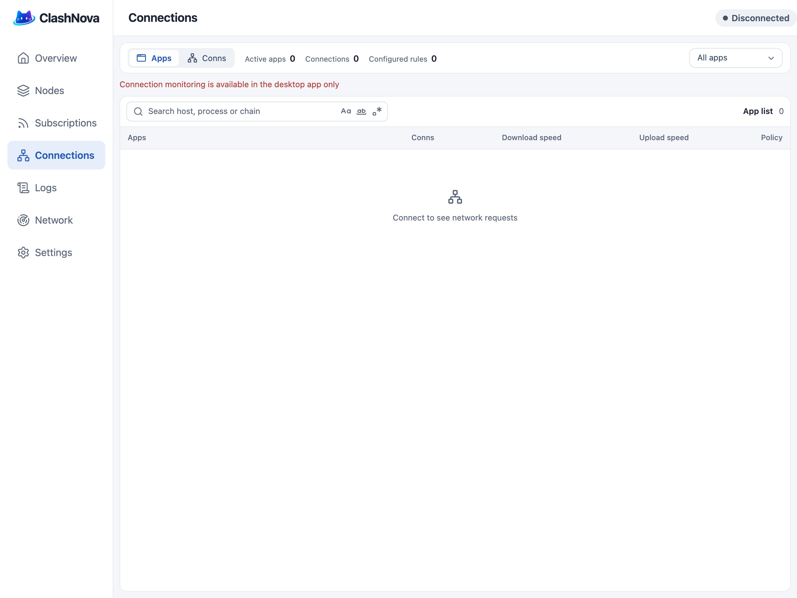

<div align="center">


<h1>ClashNova Desktop</h1>

<p>
  <b>基于 <a href="https://sing-box.sagernet.org/">sing-box</a> 的本地优先代理客户端。</b><br/>
  导入订阅即可连接 —— 解析、分流和出站连接都在本机完成。
</p>

<p>
  <a href="../../LICENSE"></a>
  
  
  
  
</p>

<p>
  <a href="../../README.md">English</a> ·
  <b>简体中文</b> ·
  <a href="README.de.md">Deutsch</a> ·
  <a href="README.fr.md">Français</a> ·
  <a href="README.ja.md">日本語</a> ·
  <a href="README.ko.md">한국어</a> ·
  <a href="README.ru.md">Русский</a>
</p>


<p><a href="https://github.com/clashnova-dev">clashnova-dev</a></p>

</div>

> 译文可能滞后于英文主文档。
## ✨ 功能

- **概览** — 一键连接或断开,实时显示连接状态、当前节点、上下行速率和本次会话用量。订阅用量、出口 IP 及其归属地就地展示(可隐藏,支持手动或定时刷新),并可在常用节点间快速切换。
- **节点** — 按名称搜索、按延迟排序,或用「测速全部」异步测量所有节点;结果陆续返回,可按最低延迟重新排序。可手动选节点,也可交给自动选择(内核的 `urltest` 分组持续挑选最快的)。
- **订阅** — 从 URL 或本地文件导入 Clash、sing-box 或通用(分享链接)订阅;格式转换在本机完成,不经过在线服务。每条订阅都能刷新、复制、移除,服务商提供时还会显示用量与到期。
- **连接与路由** — 可选**系统代理**、**手动代理**或 **TUN**(虚拟网卡,需系统授权)。在**规则**与**全局**路由间切换,并可配置本地端口、局域网访问等。活跃连接列表、内核实时日志和流量统计一应俱全。
- **系统集成** — 系统托盘、开机自启,以及浅色 / 深色 / 跟随系统主题。界面提供简体中文、English、日本語、한국어、Deutsch、Français、Русский。

## 🌟 特色功能

一些超出普通订阅客户端的能力。

### 链式代理

让流量依次经过多个节点——一个入口、任意数量的中继、一个出口。可手动搭建链路、实测端到端延迟,并把常用链路保存为命名预设。延迟会在各跳之间累加,整条链路也只和最薄弱的一环一样可靠,因此编辑器始终展示完整路径。

<p align="center"></p>

### 网络防护与检测

**网络**页集中呈现流量如何离开本机。可选择代理的生效方式——系统代理、TUN 或手动——并用通俗的说明讲清每种模式覆盖与不覆盖的范围。**Kill Switch**(TUN 模式)在隧道断开的瞬间阻断所有流量,避免回落到真实连接。按需运行健康检查(本地网络、代理可达性、DNS、出口 IP)、DNS / IPv6 / WebRTC 泄漏检测,以及流媒体 / AI 服务解锁检测。

<p align="center"></p>

### 局域网传输

在同一网络下向自己的其它设备发送文字和文件,中间不经过服务器或云。用起来像一个私人的文件助手会话:设备配对一次,之后便在会话里收发消息和文件。配对即建立信任,已配对设备可自动接收。

<p align="center"></p>

### 分流规则

查看真正生效的分流表——每条规则的类型、匹配内容、去向(直连 / 代理 / 拦截),以及它来自你的订阅还是内置默认。可按内容、类型或去向搜索,弄清某个域名为何走这条路径。

<p align="center"></p>

## 📸 截图

| 概览 | 节点 | 订阅 |
| :-: | :-: | :-: |
|  |  |  |

| 连接 | 日志 | 设置 |
| :-: | :-: | :-: |
|  |  |  |

## 🛠️ 构建

需要 Node.js 与 pnpm、Rust、Go、Python 3,以及对应平台的 Tauri 系统依赖。

```sh
cp .env.example .env
pnpm install --frozen-lockfile
python3 scripts/prepare-sidecars.py   # 从源码编译 sing-box sidecar
pnpm tauri dev                         # 开发
pnpm tauri build                       # 打包发布版本
```

`prepare-sidecars` 从源码编译内核和订阅转换器,不下载预编译二进制。Tauri 的 dev 与 build 钩子会自动运行它,改动内核源码后无需手动执行。

若不想安装 Rust 或 Go,可以只跑前端:`pnpm dev` 后在浏览器打开。`browserBridge()` 会桩掉原生侧,因此依赖内核的功能——连接、出口 IP、实时速率——仍需在真实桌面版本中验证。

## 🍎 在 macOS 上运行

发布版未做代码签名与公证(没有 Apple 开发者证书),下载后 macOS 可能拒绝打开(提示「ClashNova 已损坏」或开发者无法验证)。先解除隔离标记再正常打开,若安装在其它位置请相应修改路径:

```sh
sudo xattr -rd com.apple.quarantine "/Applications/ClashNova.app"
```

## ⚙️ 配置

规则模式仅内置局域网直连和 500 个国内常用服务及必要静态资源/CDN 域名，其余默认走所选代理，订阅规则和应用策略仍可单独指定去向。域名包含子域名，名单为人工维护的精简集合，不是实时流量排名；不再携带全国域名和 IP 段大表。TUN DNS 使用同一份直连域名名单，全局模式不应用这些内置分流。可在**规则**页面查看生成结果。

构建期选项由 Vite 从 `.env` 文件读取(已被 `.gitignore` 忽略):

```
VITE_DEFAULT_SERVER=     # 可选的后端地址,留空即作为独立订阅客户端运行
VITE_ENABLE_LOGIN=false  # 为 false 时隐藏账号登录界面
```

保持默认时,应用是一个无需服务端的独立订阅客户端。这两个开关是接入自有后端的扩展点。

## 🗂️ 项目结构

```
src/
  App.vue                 外壳:侧边导航与各页面
  composables/useApp.ts   状态中枢(会话 / 订阅 / 节点 / 连接 / 设置)
  pages/                  概览 / 节点 / 订阅 / 连接 / 日志 / 设置 / 帮助
  i18n/                   多语言消息表
  lib/                    连接状态机、订阅解析、偏好、TUN 服务
  styles/app.css          明暗两套设计令牌
src-tauri/                Tauri(Rust)宿主:窗口、托盘,以及内核与 TUN helper 的生命周期
```

实际出站流量由内置的 sing-box 内核转发。

## 📄 许可证

GPL-3.0,见 [LICENSE](../../LICENSE)。本项目链接 GPL-3.0 的 sing-box 内核,分发时须遵循同一许可证并提供相应源码。
